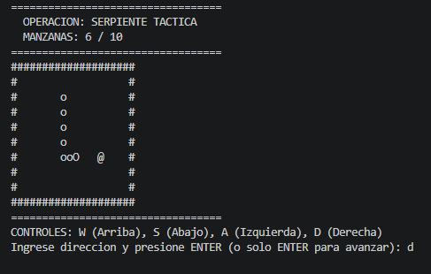
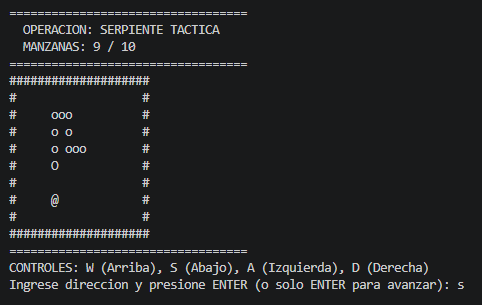
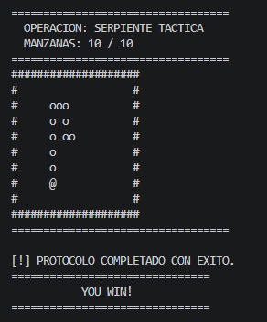

# Tarea: Mi prompt profesional 
  
## Funcionalidad elegida 
Desarrollo de un juego de la Serpiente (Snake) táctico y 100% funcional en consola (CMD), contenido estrictamente en un único archivo Java, utilizando la arquitectura MVC (Model-View-Controller) y deteniendo la ejecución con una victoria al alcanzar exactamente 10 manzanas.
  
## Version 1: prompt basico 
```text
[Crea el juego "Serpiente"]
```
* **Qué cambié:** ["Versión Inicial"]
* **Por qué:** ["Version inicial"]
* **Qué mejoró en la respuesta:** [Intento hacer el juego SERPIENTE, pero tuvo algunos fallos en la modularizacion, y la importacion de elementos, al dejar libre al vedrio sus instrucciónes.]
  
## Version 2 
```text
[Imagina que eres un desarrollador de videojuegos en Java, y creame el juego SERPIENTE, usando la practica de MVC, pero en un solo archivo.]
```
* **Qué cambié:** [Trate de ser especifico, en su ROL, el juego que va a hacer, y la primera practica que aprendi de modularizar clases y funciones, de un proyecto, pero en un solo archivo]
* **Por qué:** [Debido a la pobre instruccion de la anterior version, esta intenta ser más especifica, probando paso a paso, que puede hacer con la informacion recibida, y la verdad es que si lo logra, pero mediante más instrucciones y especifico en el resultado, tiene más claro que hacer, que no hacer y como, por lo que va mejorando en el objetivo final, entendiendo más lo que deseas.]
* **Qué mejoró en la respuesta:** [El juego funciona, pero la practica no mucho, se detiene en algunos intentos, por lo que era necesario ser más especifico.]
  
## Version 3: prompt final 
```text
[Hola gemini, necesito que nos pongamos serios, mas serios como el tipo que le pidieron que accionara los misiles y casi provocar una guerra atomica, pero decidio no hacerlo (bueno pues asi de serio...)


Toma este rol: Eres un desarrollador de java experimentado, experto en hacer programacion de videojuegos, construyendo clases de nivel, jugabilidad sin errores, y sin soltar ni un paso, prefieres hacer un nivel corto, antes que dejar algo con pocas probabilidades de exito.


Te piden hacer un juego sin necesidad de assets, solo usar el cmd, y crear un juego dificil (LA SERPIENTE).


y como reto, solo hacerlo en un solo archivo de Java, que ya tenga toda la configuracion de POO, que ya tengo todas las clases, funciones, y comportamientos necesarios para que el juego funcione, y que no hay problemas, (pero te piden que el juego termine cuando el jugador llegue a 10 manzanas, mostrando mensaje de "YOU WIN!".


Para ello, te pones a trabajar.


Organizas todos los datos en formas de getters y setters, para organizarte bien, por ejemplo: "getCantidadActual(), getEstado(), getVivo(), setCantidadActual(), setEstado, setVivo(), etc", solo un ejemplo.


Las demas clases contienen como se movera la serpiente (jugador), sistema de Ganador, o Perdio (estado de jugador), y movilidad.


Todo este juego debe de ocurrir en la propia casilla de CMD, que se abrira al jugador, y le permitira jugar.


Para mas organizacion en el codigo, basate en el modelo MVC, pero considerando que todo tiene que estar en un solo archivo...


Bien gemini, por favor, dame tu mejor esfuerzo, se que puedes ]
```
  
## Componentes del prompt final 

| Componente | Identificación en el prompt |
| :--- | :--- |
| **Rol** | Desarrollador de Java experimentado, experto en videojuegos, sumamente serio y enfocado en la ejecución impecable y sin errores. |
| **Instrucción** | Crear el juego de "La Serpiente" para CMD en un solo archivo de Java, que termine y muestre "YOU WIN!" al recolectar exactamente 10 manzanas. |
| **Contexto** | Sin necesidad de assets externos, juego de alta dificultad, comportamiento y configuraciones de POO completas. |
| **Ejemplos** | Organización de datos mediante Getters y Setters específicos (ej: `getCantidadActual()`, `getEstado()`, `getVivo()`). |
| **Formato** | Un único archivo de código Java que contenga internamente toda la estructura basada en el modelo MVC (Model-View-Controller). |
  
## Evaluacion del resultado 

| Criterio de Evaluación | Cumple (Sí / No) |
| :--- | :--- |
| 1. ¿El código se contiene de forma estricta en un único archivo `.java` compilar y ejecutar? | Sí |
| 2. ¿La lógica del programa finaliza mostrando "YOU WIN!" al llegar a 10 manzanas? | Sí |
| 3. ¿La estructura interna respeta la separación del patrón MVC (Modelo, Vista, Controlador)? | Sí |
| 4. ¿El sistema implementa correctamente POO y uso de Getters/Setters para manipular el estado? | Sí |

## Errores frecuentes evitados

1. **Ser demasiado general:** Se evitó darle a la IA una instrucción ambigua como "haz un juego de la serpiente". En su lugar, se establecieron límites precisos: 10 manzanas de objetivo, interfaz en CMD y patrón MVC estricto.
2. **Asumir información no proporcionada:** Se evitó asumir que la IA organizaría el código limpiamente al pedir un solo archivo. Para evitar espagueti, se le obligó explícitamente a usar programación orientada a objetos (POO) y se le dio el ejemplo de usar getters y setters.


## Imagenes del juego

- Nivel 6:
- Nivel 9:
- Pantalla Final del juego, y Experimento terminado: